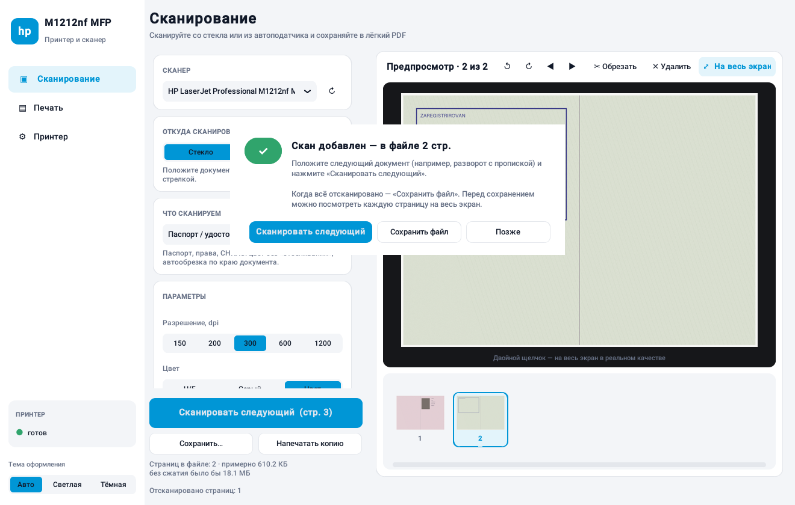

# Установка с нуля: пошаговая инструкция для новичков

Эта инструкция для Windows 10 и Windows 11. Ничего не нужно знать заранее. Просто
выполняйте шаги по порядку. Вся установка занимает **20–30 минут**, большая часть
времени уходит на скачивание.

> Если что-то пойдёт не так, загляните в раздел [«Если что-то не получилось»](#если-что-то-не-получилось)
> в конце инструкции.

**Что мы сделаем:**

1. Подключим МФУ к компьютеру.
2. Установим драйвер HP, чтобы Windows «увидела» принтер и сканер.
3. Установим Python, бесплатную программу, на которой работает наше приложение.
4. Скачаем приложение.
5. Запустим его и сделаем ярлык на рабочем столе.

---

## Шаг 1. Подключите МФУ

Выберите **один** из двух способов.

### Вариант А: через USB-кабель (проще)

1. Включите МФУ кнопкой питания и дождитесь, пока оно перестанет шуметь.
2. **Пока не подключайте USB-кабель к компьютеру!** Установщик драйвера сам скажет,
   когда это сделать (шаг 2).

### Вариант Б: через сеть (можно печатать с любого компьютера в доме)

1. Соедините МФУ с роутером сетевым кабелем (разъём сзади МФУ, похож на телефонный, но шире).
2. Включите МФУ и подождите 1–2 минуты, пока оно получит адрес в сети.
3. Узнайте адрес принтера. На панели МФУ нажмите кнопку **«Настройка»** (значок гаечного
   ключа), выберите **«Отчеты» → «Отчет о конфигурации»** и нажмите **OK**. Принтер
   напечатает лист. Найдите на нём строку **IP Address**, например `192.168.1.35`.
   Запишите этот адрес.

> Модель M1212nf **не умеет Wi-Fi**. По сети она работает только через кабель к роутеру.

---

## Шаг 2. Установите драйвер HP

Без драйвера Windows может печатать, но **не видит сканер**. Поэтому драйвер нужен обязательно.

1. Откройте сайт **https://support.hp.com/drivers** в браузере.
2. В поле поиска введите `M1212nf` и выберите **HP LaserJet Pro M1212nf Multifunction Printer**.
3. Сайт сам определит вашу Windows. Если определил неверно, нажмите «Выбрать другую ОС».
4. Откройте раздел **«Пакет ПО для драйвера»** (Driver — Product Installation Software).
   Скачайте пакет, в названии которого есть **Full Software** («Полнофункциональное ПО»).
   Если такого нет, скачайте **Basic Driver** («Базовый драйвер»).
5. Запустите скачанный файл и нажимайте **«Далее»**. Когда установщик спросит про
   подключение:
   - для **USB**: подключите кабель к компьютеру, когда установщик попросит;
   - для **сети**: выберите «Сетевое подключение» (Network). Если принтер не нашёлся
     сам, введите IP-адрес с листа конфигурации.
6. Дождитесь окончания установки и **перезагрузите компьютер**.

**Проверка.** Откройте «Пуск» → **«Параметры»** → **«Bluetooth и устройства»** (в Windows 10:
«Устройства») → **«Принтеры и сканеры»**. В списке должно быть устройство со словами
**M1212nf** в названии.

---

## Шаг 3. Установите Python

Python — это бесплатная программа, на которой работает наше приложение. Её нужно
установить один раз.

1. Откройте **https://www.python.org/downloads/**
2. Нажмите большую жёлтую кнопку **«Download Python 3.x.x»** (цифры могут быть любые, главное
   3.10 или новее).
3. Запустите скачанный файл.
4. ⚠️ **Самое важное:** в первом окне установщика внизу отметьте галочку
   **«Add python.exe to PATH»**. Без неё ничего не заработает!
5. Нажмите **«Install Now»** и дождитесь надписи **«Setup was successful»**. Нажмите **Close**.

> Если вы забыли галочку, снова запустите установщик, выберите **«Modify»** → **«Next»** и
> отметьте **«Add Python to environment variables»**. Или удалите Python через
> «Параметры → Приложения» и установите заново, уже с галочкой.

---

## Шаг 4. Скачайте приложение

1. Скачайте архив с программой по ссылке:
   **https://github.com/kvasix123/123/archive/refs/heads/claude/keen-hamilton-e1d24b.zip**

   Если эти изменения уже влиты в основную ветку, используйте ссылку
   https://github.com/kvasix123/123/archive/refs/heads/main.zip. Если репозиторий закрытый,
   сначала войдите в свой аккаунт GitHub в этом же браузере.
2. Откройте папку **«Загрузки»**, нажмите на архив **правой кнопкой** → **«Извлечь все…»** →
   **«Извлечь»**.
3. В распакованной папке найдите папку **`hp-m1212nf-app`**.
4. Скопируйте её в удобное место **с коротким путём без русских букв**, например прямо на
   диск: `C:\HP-M1212nf`. Так меньше шансов на ошибки.

Внутри должны быть файлы `app.py`, `run_windows.bat`, `requirements.txt` и другие.

---

## Шаг 5. Первый запуск

1. Откройте папку `C:\HP-M1212nf` и дважды щёлкните файл **`run_windows.bat`**.
   Если расширения файлов не показываются, он называется просто `run_windows`, а значок у
   него с шестерёнками.
2. Windows может показать синее окно **«Система Windows защитила ваш компьютер»**. Это
   нормально для файлов из интернета. Нажмите **«Подробнее»** → **«Выполнить в любом случае»**.
3. Откроется чёрное окно с надписью **«Первый запуск: создаю окружение…»**. Программа
   скачивает нужные компоненты. Это займёт **1–3 минуты**, нужен интернет. **Не закрывайте
   окно!**
4. Когда всё будет готово, откроется программа, а чёрное окно закроется само.

В следующие разы программа будет запускаться за пару секунд.

### Создайте ярлык на рабочем столе

1. Нажмите на `run_windows.bat` **правой кнопкой**. В Windows 11 сначала выберите
   **«Показать дополнительные параметры»**.
2. Выберите **«Отправить»** → **«Рабочий стол (создать ярлык)»**.
3. Ярлык можно переименовать (правая кнопка → «Переименовать»), например в «Сканер HP».

### Необязательно: сделайте один exe-файл

Если хотите обычную программу без чёрного окна и без Python, дважды щёлкните
**`build_exe.bat`**. Через 2–5 минут в папке `dist` появится файл **`HP-M1212nf.exe`**.
Его можно скопировать куда угодно и закрепить на панели задач (правая кнопка → «Закрепить
на панели задач»).

---

## Шаг 6. Проверьте, что всё работает

1. В программе слева внизу в блоке **«Принтер»** должна гореть **зелёная точка** и надпись
   «готов».
2. На экране **«Сканирование»** в поле **«Сканер»** должно быть устройство с названием
   **M1212nf**.
3. Положите любой лист на стекло лицом вниз и нажмите **«Сканировать»**.

Если сканер или принтер не найден, смотрите раздел ниже.

---

## Как пользоваться

### Отсканировать документ в PDF

1. Положите документ:
   - **на стекло**: лицом вниз, прижав к углу со стрелкой;
   - **в автоподатчик** (лоток сверху): лицом вверх, верхним краем вперёд, до 35 листов.
2. Выберите **«Откуда сканировать»**: «Стекло» или «Автоподатчик».
3. В блоке **«Что сканируем»** выберите профиль:
   - **Документ в оттенках серого** — для большинства документов;
   - **Текст, Ч/Б** — для простых распечаток, файл получится самым маленьким;
   - **Паспорт / удостоверение** — цветной скан с обрезкой по краю документа;
   - **Фото** — для фотографий.
4. Нажмите **«Сканировать»**.
5. Нажмите **«Сохранить…»**, выберите папку и нажмите «Сохранить».

### Несколько документов в один файл (например, паспорт)

1. Выберите профиль **«Паспорт / удостоверение»**. Он сам включит режим серии.
2. Положите паспорт разворотом с фото на стекло и нажмите **«Сканировать»**.
3. Появится окно **«Скан добавлен»**. Переверните паспорт на страницу с пропиской и
   нажмите **«Сканировать следующий»**.
4. Повторите для всех нужных страниц и нажмите **«Сохранить файл»**.

Если нужно как на ксерокопии, два разворота на одном листе A4, в блоке **«Несколько
документов в один файл»** выберите **«2 скана на A4»**. Размер документа при этом
сохранится реальный, 1:1.

### Проверить качество скана перед сохранением

Нажмите **«На весь экран»** или дважды щёлкните по странице. Откроется полноэкранный
просмотр, который показывает страницу **точно такой, какой она будет в файле**, со всеми
следами сжатия. Внизу указан размер этой страницы в килобайтах.

- **Колёсико мыши** приближает и отдаляет.
- **Перетаскивание мышью** сдвигает изображение.
- Клавиша **1** включает масштаб 100 %, при котором видны настоящие пиксели скана.
  Клавиша **0** вписывает страницу в экран.
- Стрелки **← →** листают страницы, **Esc** закрывает просмотр.

Если мелкий текст выглядит размытым, передвиньте ползунок **«Сжатие»** вправо или выберите
600 dpi. Если файл слишком большой, передвиньте ползунок влево.

### Распечатать файл

1. Перейдите на экран **«Печать»** и нажмите **«Добавить файлы»**.
2. Укажите количество копий и, если нужно, страницы (например, `1-3, 5`).
3. Нажмите **«Печать»**.

**Двусторонняя печать.** Включите переключатель **«Двусторонняя (вручную)»**. Программа
напечатает первую сторону и покажет подсказку. Возьмите стопку из лотка, **не
переворачивая и не перемешивая листы**, и положите обратно во входной лоток чистой
стороной вверх. Нажмите **«Печатать вторую сторону»**. Если обороты вышли вверх ногами,
включите галочку «Повернуть 2-ю сторону на 180°». Программа запомнит этот выбор.

### Сделать копию (как на ксероксе)

Отсканируйте документ и нажмите **«Напечатать копию»**.

### Тёмная тема

Внизу слева, в блоке **«Тема оформления»**: «Авто» (как в Windows), «Светлая» или «Тёмная».

---

## Если что-то не получилось

| Что случилось | Что делать |
|---|---|
| Чёрное окно пишет **«Python не найден»** | Python не установлен или при установке не была отмечена галочка «Add python.exe to PATH». Повторите шаг 3. |
| Чёрное окно пишет **«Не удалось установить компоненты»** | Проверьте интернет и запустите `run_windows.bat` ещё раз. Если не помогло, временно отключите антивирус и попробуйте снова. |
| Чёрное окно мелькнуло и пропало, программа не открылась | Откройте папку программы, щёлкните в адресную строку проводника, напечатайте `cmd` и нажмите Enter. В открывшемся окне введите `.venv\Scripts\python app.py` и нажмите Enter. Текст ошибки появится на экране. |
| Программа показала **«Непредвиденная ошибка»** | Подробности записаны в файл `hp_m1212nf_error.log` в вашей личной папке (`C:\Users\ВашеИмя`). Пришлите его тому, кто помогает с программой. |
| **«Сканер не найден»** | 1) Проверьте, что МФУ включено. 2) Установите **полный** драйвер HP (шаг 2), базового может не хватить. 3) Перезагрузите компьютер. 4) В программе нажмите кнопку **↻** рядом со списком сканеров. |
| **«Сканер занят»** | Закройте другие программы сканирования (HP Scan, «Факсы и сканирование Windows») и попробуйте снова. |
| **«Сканер недоступен»** при подключении по сети | Компьютер и МФУ должны быть подключены к одному роутеру. Выключите и включите МФУ. Проверьте, что IP-адрес на листе конфигурации не изменился. |
| **«В автоподатчике нет бумаги»** | Положите листы лицом вверх и задвиньте их до упора, пока не остановятся. |
| Печать не идёт, задания висят | Экран **«Принтер»** → **«Очистить очередь»**, затем выключите и включите МФУ. |
| Печать бледная или с полосами | Заканчивается тонер. Картридж для этой модели — **HP 85A (CE285A)**. Временно помогает вынуть картридж и аккуратно покачать его из стороны в сторону. |
| Ч/Б скан теряет печати и подписи | Выберите профиль «Документ в оттенках серого». |

### Как обновить программу

Скачайте новый архив (шаг 4) и скопируйте файлы из новой папки `hp-m1212nf-app` поверх
старых в `C:\HP-M1212nf` (на вопрос Windows ответьте «Заменить»). Папку `.venv` трогать не
нужно: недостающие компоненты программа доставит сама при следующем запуске.

### Как удалить программу

Удалите папку `C:\HP-M1212nf` и файл `.hp_m1212nf_app.json` в вашей личной папке
(`C:\Users\ВашеИмя`). Python можно удалить через «Параметры → Приложения».
