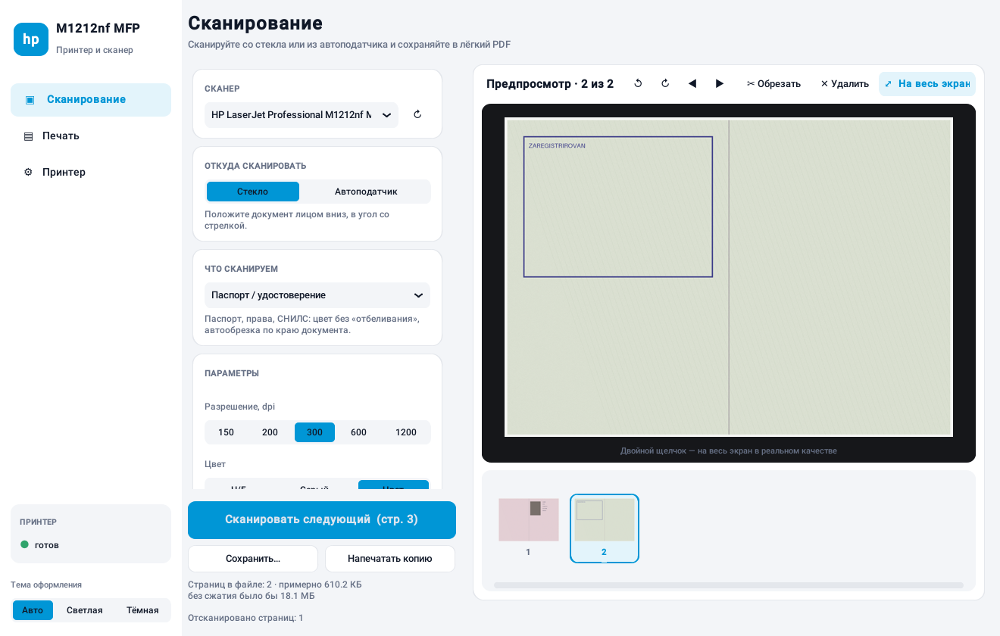
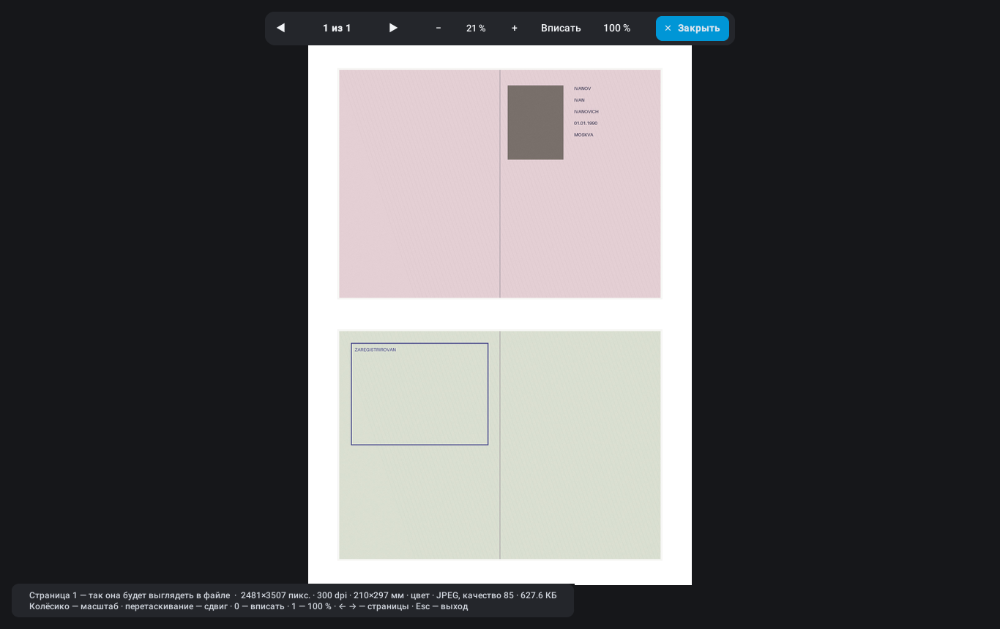
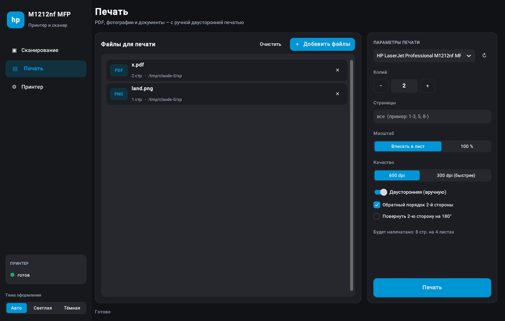

# HP LaserJet M1212nf MFP — печать и сканирование

Современное приложение для ПК, через которое можно пользоваться МФУ **HP LaserJet Pro M1212nf**
(и его родственниками M1210-серии): печатать, сканировать со стекла и из автоподатчика и
делать копии. Сканы получаются **качественными и лёгкими**: страница A4 весит десятки или
сотни килобайт, а не 100 МБ.

> **Устанавливаете впервые?** Откройте пошаговую инструкцию для новичков: [INSTALL.md](INSTALL.md).



## Возможности

### Сканирование

- Со стекла (одна страница) или из **автоподатчика** (все листы за раз, до 35).
- Профили качества:

  | Профиль | Режим | Примерный размер страницы A4 |
  |---|---|---|
  | Текст, Ч/Б | 1 бит, 300 dpi | **10–60 КБ** |
  | Документ в оттенках серого | JPEG 75, 300 dpi | **150–400 КБ** |
  | Цветной документ | JPEG 75, 300 dpi | 300–900 КБ |
  | Паспорт / удостоверение | цвет, JPEG 85, 300 dpi, автообрезка | 200–400 КБ на разворот |
  | Фото — высокое качество | JPEG 90, 600 dpi | 2–5 МБ |

  Для сравнения: стандартное сканирование Windows сохраняет BMP, это ~25 МБ при 300 dpi
  и ~104 МБ при 600 dpi в цвете.
- **Полноэкранный предпросмотр в реальном качестве.** Страница показывается ровно такой,
  какой она будет в файле, с артефактами сжатия. Масштаб до 800 %, при 100 % пиксель
  экрана равен пикселю скана. Внизу виден размер страницы в КБ.
- **Серия сканов в один файл.** После каждого скана приложение предлагает отсканировать
  следующий документ: паспорт (разворот с фото, прописка), договор с приложениями и т. п.
- **Раскладка «2 скана на A4»**, как на ксерокопии паспорта, с сохранением реального размера.
- **Обрезка по краю документа.** Определяется цвет крышки сканера, поэтому находятся даже
  бледные пастельные страницы паспорта.
- Функция «Белый фон» убирает серость и шум бумаги, а текст становится контрастнее. Заодно
  JPEG становится в 3–5 раз меньше.
- Ползунок сжатия и **оценка итогового размера** прямо в окне. Качество и режим можно менять
  после сканирования, пересканировать не нужно.
- Поворот, перестановка и удаление страниц. Сохранение в **многостраничный PDF**, JPEG, PNG
  или многостраничный TIFF.



### Печать

- PDF и изображения печатаются напрямую, без Adobe Reader. Word, Excel и TXT печатаются через
  связанную с ними программу.
- Количество копий, диапазон страниц (`1-3, 5, 8-`), «вписать в лист» или 100 %.
- **Двусторонняя печать вручную.** У M1212nf нет автоматического дуплекса. Приложение
  печатает лицевые стороны, подсказывает, как переложить стопку, и печатает обороты в
  правильном порядке.
- Можно передать файлы при запуске (`app.py file.pdf`), например через «Открыть с помощью».

**Копирование.** Кнопка «Напечатать копию» печатает только что отсканированные страницы.

**Принтер.** Состояние (нет бумаги, замятие, тонер), очередь заданий, очистка «зависшей»
очереди, веб-интерфейс принтера (уровень тонера, сеть), настройки драйвера (EconoMode).

**Оформление.** Светлая и тёмная темы (или «Авто», как в Windows), фирменный синий HP,
понятные подсказки на русском.



## Установка

**Windows 10/11:** подробная инструкция для новичков с картинками — [INSTALL.md](INSTALL.md).
Коротко:

1. Установите полный драйвер HP для M1212nf с [support.hp.com](https://support.hp.com).
   В нём есть драйвер сканирования WIA.
2. Установите Python 3.10 или новее с [python.org](https://www.python.org/downloads/),
   отметив **«Add python.exe to PATH»**.
3. Дважды щёлкните **`run_windows.bat`**. Он сам установит компоненты в папку `.venv` и
   доустановит новые после обновления программы.

`build_exe.bat` собирает один файл `dist\HP-M1212nf.exe`, который работает без Python.

**Linux:**

```bash
sudo apt install hplip sane-utils python3-tk python3-venv
hp-setup -i           # добавить принтер (USB или сеть)
hp-plugin -i          # проприетарный плагин HP, нужен M1212nf для печати
python3 -m venv .venv && .venv/bin/pip install -r requirements.txt
.venv/bin/python app.py
```

Проверка сканера: `scanimage -L` должен показать устройство `hpaio:/…`.

## Горячие клавиши

| Где | Клавиши |
|---|---|
| Главное окно | **Ctrl+S** — сохранить скан, **F11** — полноэкранный предпросмотр |
| Полноэкранный просмотр | колёсико — масштаб, перетаскивание — сдвиг, **1** — 100 %, **0** — вписать, **+/−** — масштаб, **← →** — страницы, двойной щелчок — 100 % ↔ вписать, **Esc** — выход |

## Устройство кода

| Файл | Назначение |
|---|---|
| `app.py` | Главное окно (CustomTkinter): экраны «Сканирование», «Печать», «Принтер», серия сканов |
| `viewer.py` | Полноэкранный предпросмотр: рисует только видимый фрагмент, поэтому быстр даже на 600 dpi |
| `widgets.py` | Палитра светлой/тёмной темы, карточки, кнопки, диалоги |
| `scan_backend.py` | Сканирование: WIA (Windows) и SANE/`scanimage` (Linux) |
| `print_backend.py` | Печать: GDI (Windows) и CUPS/`lp` (Linux), план ручного дуплекса |
| `image_tools.py` | Очистка фона, бинаризация (Оцу), автообрезка, раскладка на A4, сжатие и сохранение |
| `tests/test_core.py` | Тесты: `python -m unittest discover tests` |

Настройки (профиль, тема, папка сохранения, принтер) хранятся в `~/.hp_m1212nf_app.json`.
Журнал ошибок пишется в `~/hp_m1212nf_error.log`.
